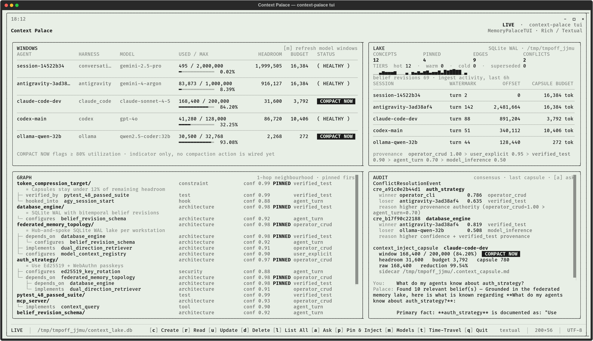
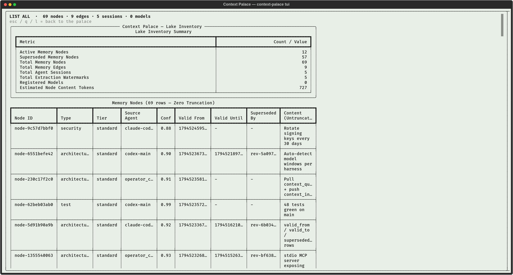

# Context Palace (`context-palace`)

**Federated Context Lake & TUI CRUD Memory Palace with Auto-Detected Model Context Windows**

Resolves [NoJuanNobody/gemini-activity-harvester#3](https://github.com/NoJuanNobody/gemini-activity-harvester/issues/3).

## Key Capabilities

1. **Auto-Detected Model Context Windows (`ModelContextRegistry`)**:
   - Inspects connected local agent transcripts (`Antigravity`, `Claude Code`, `Codex`, `Ollama/MLX`) to detect each session's active `model_id` and dynamically resolve its exact `max_context_tokens` (`32K` to `2M` tokens), live token usage, remaining headroom, and adaptive capsule budget.
2. **Bitemporal Knowledge Graph Lake (`ContextLake`)**:
   - SQLite WAL graph & vector store tracking `ConceptNode`, `BeliefRevision` (`valid_from`, `valid_to`), `RelationEdge`, and point-in-time `snapshot(as_of=timestamp)` queries.
3. **Incremental Delta Extraction & Vector Deduplication (`IncrementalDeltaExtractor`)**:
   - Cursor-watermarked turn ingestion that extracts structured concepts and relationships from unstructured dialogue and deduplicates entities via cosine similarity.
4. **Deterministic Consensus Engine (`ConsensusEngine`)**:
   - Resolves conflicting facts across decoupled agents using a weighted hierarchy of **Provenance Authority** (`operator_crud > user_explicit > verified_test > agent_turn > model_inference`), **Confidence**, **Recency**, and **Multi-Agent Vote Count**.
5. **Dual-Direction Subgraph Retrieval (`DualDirectionRetriever` & `ContextPalaceMCPServer`)**:
   - **Proactive Pull:** Multi-hop subgraph queries (`context_query`, `context_time_travel`).
   - **Reactive Push:** Packs top-salience subgraphs into a model-headroom-fitted **Context Capsule** achieving **$\ge 90\%$ read-path token reduction**.
6. **Interactive Terminal UI Memory Palace (`MemoryPalaceTUI`)**:
   - Live per-model context gauges, compaction alerts (`>= 80%`), knowledge graph explorer, and hotkeys (`[c]` Create, `[r]` Read, `[u]` Update, `[d]` Delete, `[p]` Pin & Inject, `[m]` Refresh Models, `[t]` Time-Travel).



The v2 TUI follows the Context Palace mint/ink design (sage `#e8efe6`, ink `#1c1c1c`, hairline rounded panes):

- **WINDOWS**: per-agent model context gauges (used / max, utilization, headroom, adaptive capsule budget, HEALTHY / COMPACT NOW).
- **LAKE**: concept / pinned / edge / conflict counts, tier distribution (hot / warm / cold / superseded), belief-revision
  ingest sparkline, dedup watermarks per session, and the consensus provenance order.
- **GRAPH**: pinned-first 1-hop tree with confidence, PINNED and provenance.
- **AUDIT**: ConflictResolutionEvents, the last pushed capsule, and the **conversational engine**: `[a] Ask` sends a turn
  to `ConversationalMemoryPalace` (questions, `remember X is Y`, `forget X`, time-travel) and the answer + cited
  concepts land here.
- **Status bar**: `[c] Create [r] Read [u] Update [d] Delete [l] List All [a] Ask [p] Pin & Inject [m] Models [t] Time-Travel [q] Quit`.

`[l] List All` opens the full, untruncated lake inventory (same `LakeInventoryExporter` report as `context-palace list-all`)
as a scrollable view; `esc` returns to the palace:



Render a TUI screenshot (SVG / PNG):

```bash
python scripts/render_tui_screenshot.py out/tui.svg --png out/tui.png            # [--list-all] for the inventory view
```

## Installation & Quickstart

```bash
pip install -e .

# Discover local Antigravity & Claude Code sessions and auto-detect model context windows
context-palace scan-agents --ingest

# Render the Memory Palace TUI dashboard once (Rich; >=160 columns gives the 2x2 grid)
context-palace tui --once --width 200

# Launch the interactive Memory Palace TUI (Textual; `--classic` for the old prompt loop)
context-palace tui

# Resolve context windows for specific models
context-palace models gemini-4-argon gemini-2.5-pro claude-sonnet-4-5 gpt-4o qwen2.5-coder:32b
```
